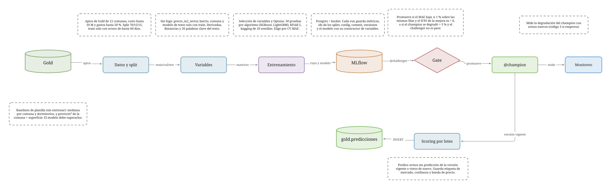
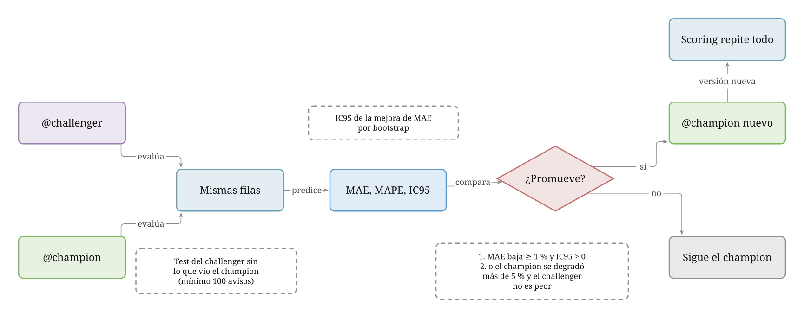
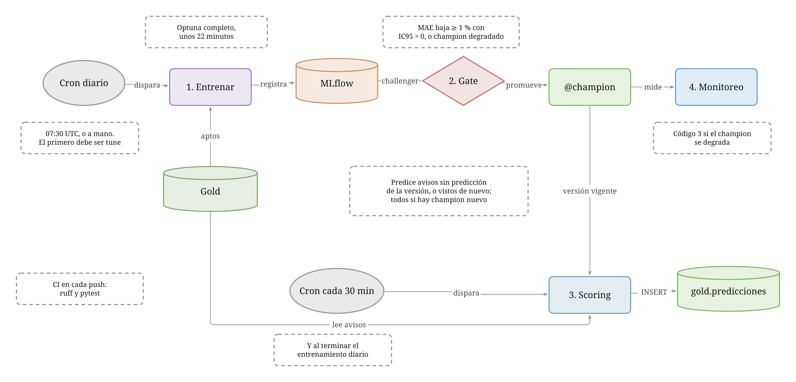

# santiago-rentals-ml

Etapa de desarrollo del modelo de ML para estimar si un arriendo de departamento en la Región Metropolitana está caro, barato o a precio de mercado.

## Contrato con `santiago-rentals-elt`

- La única entrada es `gold.aviso_entrenamiento` (filtrar `apto_entrenamiento`). Este repo nunca lee Bronce ni Silver.
- Los scrapers y la construcción de Silver/Gold viven en `santiago-rentals-elt`; aquí solo se lee Gold; la única escritura prevista es `gold.predicciones`, con el rol `ml_scoring`.
- Las variables que usan estadísticos del conjunto (`nivel_barrio`, `precio_m2_sector`, imputación de superficie) se ajustan **solo con train**, para no repetir la fuga de datos de Concepción (ver `docs/01_antecedentes_concepcion_y_databricks.md` en el repo ELT).

## Estructura

```
config.yaml · Makefile · requirements.txt · features_seleccionadas.json
src/        common, features (sin fuga), models, etiquetas,
            seleccion_variables, train, tune, register, promote
tests/      datos sintéticos
docs/       01_decisiones.md (qué se decidió), 02_plan.md (en qué orden se construye)
            diagramas/ (diagramas de proceso hechos con Fluyo: .svg y .fluyo.json; ver más abajo)
```

## Diagramas

Hechos con [Fluyo](https://fluyo.space). Cada diagrama es un `.svg` (vista estática, la que se ve aquí) y un `.fluyo.json` en
`docs/diagramas/`; ese archivo se abre con el botón **Abrir** de fluyo.space para reproducir sus **Historias** (el orden en el
tiempo de un proceso, animado) y exportar un GIF. Los scripts que los generan están en `docs/diagramas/herramientas/` (ver su
`LEEME.md`).

### Arquitectura del modelo



De los datos de Gold al modelo en uso y sus predicciones:

- **Datos y split.** Avisos aptos de Gold de 12 comunas, con costo hasta 10 M y gastos hasta el 50 % del arriendo. Se divide
  70/15/15 y el entrenamiento solo usa avisos de hasta 60 días.
- **Variables.** Sin fuga de datos: `precio_m2_sector`, barrio, comuna y el modelo de texto se ajustan solo con train. Incluye
  variables derivadas, distancias a centros y 26 palabras clave del texto del aviso.
- **Entrenamiento.** Selección de variables y búsqueda de hiperparámetros (Optuna: 50 pruebas por algoritmo, XGBoost y
  LightGBM, validación cruzada de 5 partes) con un ensamble de 10 semillas. Elige por el error de la validación cruzada.
- **MLflow** guarda cada run: métricas, ids de los splits, configuración, commit y el modelo con su constructor de variables.
- **Gate y `@champion`.** El candidato (`@challenger`) pasa por el gate de promoción (siguiente diagrama); si gana, queda como
  `@champion`.
- **Monitoreo** mide la degradación del champion con avisos nuevos (código 3 si empeora).
- **Scoring por lotes.** El champion predice los avisos sin predicción de su versión o visitados de nuevo y guarda en
  `gold.predicciones` la etiqueta de mercado (oportunidad, precio de mercado o caro), la confianza y la banda de precio.
- **Baselines de planilla** (mediana por comuna y dormitorios; precio por m² de la comuna × superficie): lo que haría una
  persona sin entrenar nada. El modelo debe superarlos.

Historias: *Entrenamiento y promoción de un modelo* y *Scoring de los avisos con el champion*.

### Promoción de modelos



Cómo decide el gate si un modelo nuevo reemplaza al champion. Se evalúan los dos sobre **las mismas filas**: el test del
challenger sin los avisos que el champion usó para entrenar o validar (ninguno los vio; mínimo 100 avisos). Se calculan el MAE
y el MAPE de cada uno y la diferencia de MAE con su intervalo de confianza al 95 % (bootstrap). El challenger **se promueve**
si:

1. el MAE baja al menos 1 % y el intervalo de la mejora es mayor que 0 (no basta con ruido), o
2. el champion se degradó más de 5 % (su MAE actual contra el de su test original) y el challenger no es peor.

Sin champion, el primero se promueve. Con un modelo nuevo, el scoring vuelve a predecir todos los avisos con esa versión.

Historias: *Mejora significativa: se promueve*, *Empate: el gate rechaza al challenger* y *El champion se degradó: entra el
challenger*.

### ML automático en GitHub



Qué corre solo en GitHub Actions y con qué condiciones:

- **Entrenamiento diario** (cron a las 07:30 UTC, o a mano con *Run workflow*). Descarga Gold, entrena con Optuna completo
  (unos 22 minutos), registra el challenger y corre el gate. El primer entrenamiento debe ser un `tune`: el MLflow parte vacío
  y el primer modelo se promueve sin comparación. Al final corre el monitoreo, que no detiene el flujo.
- **Scoring** cada 3 horas y al terminar el entrenamiento: predice los avisos que no tienen predicción de la versión vigente o
  que se visitaron después de la última, y todos si hay un champion nuevo. Escribe con un rol que solo puede insertar en
  `gold.predicciones`.
- **CI** en cada push: `ruff` y `pytest`, sin secretos.
- MLflow vive en Postgres y un bucket de Supabase; los secretos y variables están en el repo de GitHub.

Historias: *Entrenamiento diario: el challenger gana*, *El gate rechaza al challenger* y *Scoring cada 3 horas*.

## Cómo ejecutar

Con el entorno conda `data-science` y un `.env` propio con `BD_STRING_READ`, el connection string del rol
`ml_lectura` (solo `SELECT` sobre `gold.aviso_entrenamiento`). `BD_STRING_SCORING` es el del rol `ml_scoring`
(ese `SELECT` más `INSERT` en `gold.predicciones`), para el scoring por lotes que aún no existe. El `.env` no
se versiona.

```bash
python -m src.tune                  # reselecciona variables y luego Optuna (50 trials) por algoritmo
python -m src.seleccion_variables   # solo la selección (tune ya la ejecuta; --sin-seleccion la omite)
python -m src.train                 # modelos base
python -m src.register              # mejor por cv_mae -> @challenger
python -m src.reentrenar            # reentrena con los hiperparámetros del último tune (el flujo diario)
python -m src.scoring               # predice con el champion los avisos pendientes -> gold.predicciones
python -m src.promote               # quality gate -> @champion (0 promueve, 1 sin challenger, 2 rechaza)
python -m src.monitoreo            # degradación del champion con avisos nuevos (3 = degradado)
python -m pytest && python -m ruff check src tests
mlflow ui --backend-store-uri sqlite:///mlflow.db
```

## Automatización (GitHub Actions)

| Workflow | Cuándo | Qué hace |
|---|---|---|
| `ci.yml` | cada push y PR | `ruff` y `pytest` (datos sintéticos, sin secrets) |
| `entrenar.yml` | todos los días 07:30 UTC y a mano | Optuna completo (`src.tune`, unos 22 min en el runner; a mano también `modo=reentrenar`, con los hiperparámetros del último Optuna); registra el challenger, corre el gate y el monitoreo; si terminó bien, llama a `scoring.yml` |
| `scoring.yml` | cada 3 horas, al final del entrenamiento y a mano | predice con el `@champion` los avisos de Gold sin predicción de esa versión (nuevos, visitados de nuevo o todos si cambió el modelo) y los guarda en `gold.predicciones` |

- **Primera vez:** lanzar `entrenar` a mano con `modo=tune`; el reentrenamiento diario necesita un `tune` previo.
- **Gate para correr a diario:** promueve solo con mejora de MAE de al menos 1 % y con el IC95 de la mejora sobre 0
  (`gate.exigir_ic`), o si el champion está degradado y el challenger no es peor. Así el ruido no cambia el champion
  ni obliga a repetir todas las predicciones.
- **MLflow en la nube:** metadatos en Postgres de Supabase (rol `mlflow`, schema `mlflow`) y artefactos en un bucket
  de Supabase Storage. Variables: `MLFLOW_TRACKING_URI`, `MLFLOW_ARTIFACT_ROOT`, `MLFLOW_S3_ENDPOINT_URL`,
  `AWS_ACCESS_KEY_ID`, `AWS_SECRET_ACCESS_KEY` y `AWS_DEFAULT_REGION`; en local van en `.env.nube` (ignorado por git),
  que se carga solo cuando se quiere apuntar a la nube. En GitHub son secrets y variables del repo, junto con
  `BD_STRING_READ` y `BD_STRING_SCORING`.
- **Gold fresco:** el orquestador del ELT reconstruye Silver y Gold cada 3 horas. Si al descargar Gold su `construido_en` tiene más de 36 h, el entrenamiento deja una advertencia (`common.GOLD_MAX_HORAS`) en el log y en el resumen del workflow; no aborta.
- **Los scrapers no corren aquí:** el portal redirige a las IPs de Actions a un muro de verificación. El ELT sigue local;
  Actions toma lo que haya llegado a Gold.
- Las credenciales se limpian de espacios y saltos de línea al cargarlas (`common.limpiar_entorno`): un salto final al pegar un secret en GitHub rompía la conexión (el nombre de la base lo incluía).
- Las versiones de `requirements.txt` están fijadas: el modelo se guarda con pickle y debe cargarse con las mismas
  librerías en el PC y en Actions.

La primera corrida descarga Gold a `data/` (fuera de git) y las siguientes la reutilizan.

## Decisiones tomadas

Detalle en `docs/01_decisiones.md`. En resumen:

- Dos repos separados (`elt` local, `modelo` en GitHub Actions); el contacto es solo Gold.
- Modelos: XGBoost y LightGBM de Concepción, cada uno con Optuna (50 trials, KFold 5 solo sobre train).
- La selección de variables se rehace en cada entrenamiento (`tune`), con los mismos datos; una lista calculada
  con otros datos hace fallar la corrida.
- Train usa solo avisos publicados hasta 60 días antes de la última visita (`datos.ventana_dias`): los precios de
  oferta viejos suelen estar desactualizados. Validación y test quedan completos, para comparar con el champion.
- Etiqueta de mercado y confianza (como en Concepción): el scoring compara el costo total publicado con lo que el modelo
  espera, normalizado por decil de costo (mediana y MAD): `oportunidad` (z < -1), `caro` (z > 1) o `precio_de_mercado`; y
  clasifica la confianza por el desacuerdo de las 10 predicciones del ensamble (terciles: alta, media o baja). Guarda
  también la banda de costo que sería precio de mercado. Todo va en `gold.predicciones`; `--recalcular` repite el scoring.
- Baselines de planilla (mediana por comuna y dormitorios; precio/m2 de la comuna × superficie): cada run registra su MAE y la ganancia del modelo sobre el mejor (`ganancia_vs_mejor_baseline_pct`).
- Comunas fuera del modelo (`datos.comunas_excluidas`): Las Condes, Vitacura, Lo Barnechea y las periféricas del sur; sus avisos siguen en Gold y se descartan al preparar los datos. Con 12 comunas el MAPE del test es 9,3 %.
- `mlruns/` conserva solo lo del `@champion` vigente y el último run de cada algoritmo; tras cada promoción se limpia con `mlflow gc`.
- Variables derivadas: razones de superficie, equipamiento agregado y distancias en km al centro de la comuna,
  Plaza de Armas, El Golf, Las Condes y Providencia (puntos en `config.yaml`).
- Texto del aviso (título y descripción, sin números ni símbolos de dinero, para que el precio escrito no se
  cuele): 26 palabras clave (remodelado, estrenar, terraza, precio promocional, etc.) y un modelo de texto
  (TF-IDF + ridge) que estima el costo por m2 y entrega una variable más (`tx_pred_log_m2`). Para las filas de
  train es una predicción fuera de muestra (CV de 5 grupos), así que no conoce su propio precio; val, test y
  avisos nuevos usan el modelo ajustado con todo train. Vive dentro del constructor y se guarda con el modelo.
- Target: `costo_total_clp`.
- Arquitectura del webinar `jcbf08/Webninar_SDC_mlflow`: `train` → `tune` → `register` → `promote` (quality gate) → `predict`, con MLflow y alias `@challenger` / `@champion`.
- MLflow local al inicio; Postgres y Storage de Supabase al automatizar.
- Sin API pública: scoring por lotes que escribe en `gold.predicciones`.

## Decisiones pendientes

- Umbrales del quality gate (se fijan tras la primera corrida base).
- Estrategia de validación definitiva (estratificada por precio, temporal o ambas) y manejo del sesgo de supervivencia entre avisos activos y finalizados.
- Si el CI y el scoring usan un `Dockerfile` o el runner directo.
